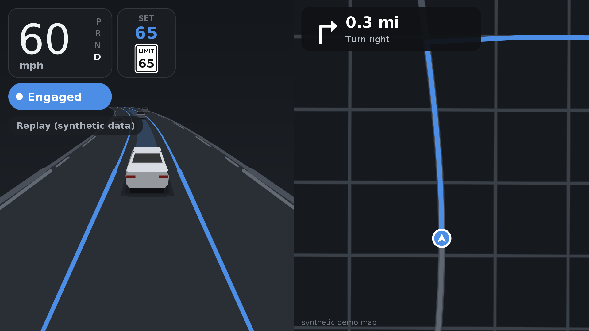
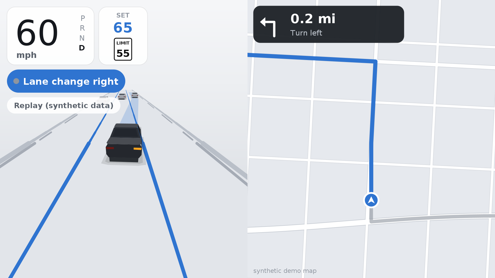
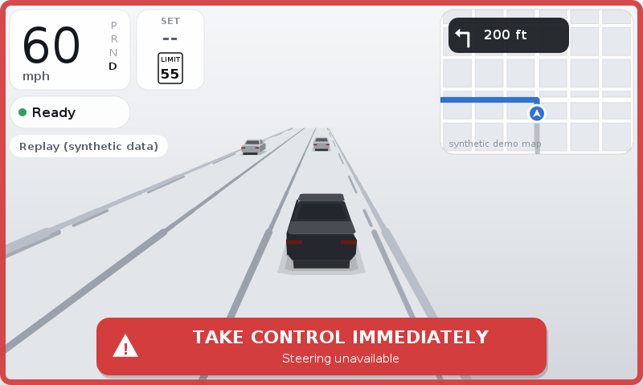
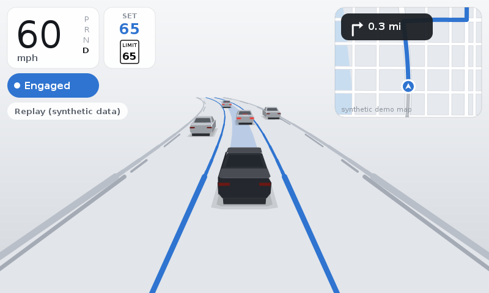
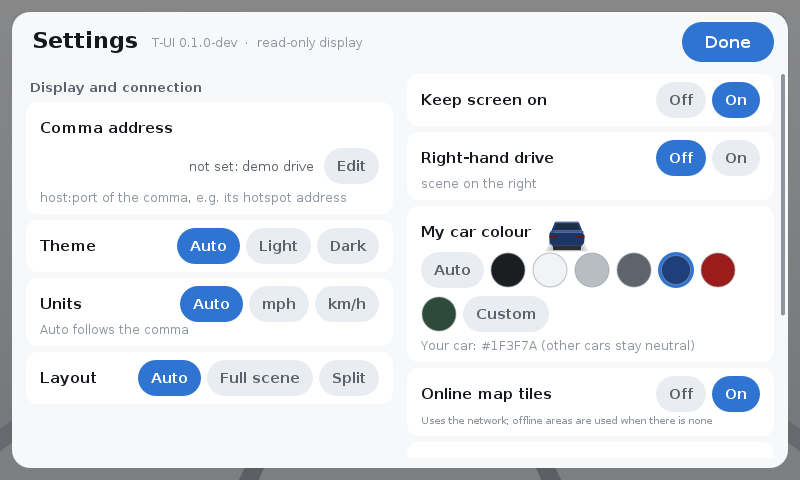
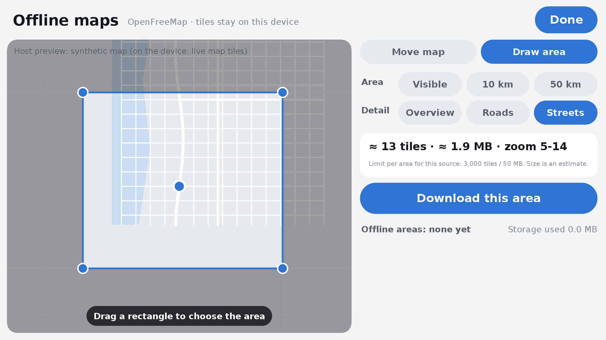

# T-UI

A driving display for openpilot/StarPilot: shows what the car's driver-assistance system sees (lane lines, path,
lead car, other cars, engagement, set speed, speed limit, alerts) on an Android head unit, tablet or phone.

Status: **v0.3 in development** (not yet run on a device). Not released. Not tested on a device yet.

License: [Apache License 2.0](LICENSE) (see [NOTICE](NOTICE)). Third-party notices: [THIRD_PARTY.md](THIRD_PARTY.md).
The comma-side HUD API patch lives in its own repository under the MIT licence:
<https://github.com/mlocoteta/t-ui-comma-patch>.

| Drive (night) | Lane change | Takeover alert (800x480) |
|---|---|---|
|  |  |  |
| **Traffic (800x480)** | **Settings** | **Offline maps** |
|  |  |  |

Screenshots are host renders of a synthetic demo drive (no real data).

## What v0 is

- One APK for Android 5+ (target: Android 9+ aftermarket head units and tablets), single screen, landscape or portrait.
- Reads a StarPilot comma's `GET /api/hud` (polled ~4 Hz) and `GET /api/hud/scene` (NDJSON stream, 10 Hz) over the
  comma's Wi-Fi hotspot. Read-only: the app has no way to change anything on the comma or the car.
- No root, no server, no phone app, no account, no analytics. The only permission is network access.
- With no comma address set it plays a built-in **synthetic** demo drive (made-up road, no real data).
- Long-press the screen (while parked) for settings: comma address, theme (auto / light / dark), units
  (auto / mph / km/h), layout (automatic / full scene + floating cards / split scene and map), keep screen on,
  right-hand drive. Settings are saved on the device.
- Smooth easing between comma frames, day / night themes, takeover banner with a pulsing red edge, a
  "No comma found" help screen.
- Map (docs/MAP.md): live and offline vector maps with MapLibre Native in the Gradle build (OpenFreeMap by default, no
  API key, attribution shown, offline areas within the source's limits); the lean build uses a built-in renderer.
  Position and route come from the comma; the app has no location permission.
- Optional add-ons for specific cars are separate and never in the default app (docs/ADDONS.md).

Not affiliated with comma.ai, StarPilot, or any car maker. openpilot is a driver-assistance system: the driver is
responsible at all times. This app is a secondary display; watch the road and the comma's own alerts.

## What you need
- An Android device for the display: Android 6+ for the MapLibre build (live / offline maps), Android 5+ for the lean
  build (built-in map). Aftermarket Android head units and tablets are the main target.
- A comma device running openpilot with the **HUD API** (`GET /api/hud`, `GET /api/hud/scene`, `GET /api/hud/route`):
  today this is a patch on top of StarPilot's Galaxy web server: <https://github.com/mlocoteta/t-ui-comma-patch>
  (docs/COMMA-SIDE.md). Stock openpilot and stock
  StarPilot do not serve these endpoints yet.
- The display joined to the comma's Wi-Fi hotspot (or the same network).

## Install (APK from GitHub Releases)
T-UI is distributed only as APKs on this repository's Releases page (no app store). Pick ONE build:
- `t-ui-<version>-maplibre.apk`: Android 6+, live and offline maps (recommended for tablets and modern head units).
- `t-ui-<version>-lean.apk`: Android 5+, small, built-in map only (older or slow units).
Both use the same package and signing key, so you can switch by installing the other one over it.

1. Download the APK and `SHA256SUMS`; check it: `sha256sum -c SHA256SUMS --ignore-missing`.
   Optional: `apksigner verify --print-certs <apk>` and compare the certificate SHA-256 with the one published below.
2. Allow installing it: Android 8+ asks to allow "Install unknown apps" for the app you open the APK with (browser or
   file manager); Android 5-7: Settings -> Security -> Unknown sources.
3. Install: open the APK on the device, or from a computer `adb install -r t-ui-<version>-<build>.apk`.
4. Head units: copy the APK to a USB stick and open it with the unit's file manager. Some units hide this behind
   developer options or a vendor "app install" switch; some vendor firmwares only run allow-listed apps (then a
   head-unit add-on or the vendor's own method is needed). Auto-start at ignition is not built in yet.
5. Updates: no auto-update. Watch the Releases page and install the newer APK over the old one (settings and offline
   maps are kept). Release signing certificate SHA-256:
   `8C:9B:D3:93:02:1E:10:CB:08:9A:B5:DE:48:55:4B:A6:53:C7:52:7F:59:F5:30:A7:72:89:A7:8F:D4:DF:1F:AE`

## Run
1. Open T-UI. With no address set it plays a synthetic demo drive.
2. Long-press the screen -> Settings -> Comma address: the comma's address and Galaxy port, e.g. `<comma-ip>:8082`.
3. Drive. Settings also hold theme, units, layout, keep-screen-on, right-hand drive, my car colour, map source and
   offline map areas.

## Troubleshooting
- "No comma found": check the Wi-Fi network, the address/port, and that the comma build serves `/api/hud`
  (open `http://<comma-ip>:8082/api/hud` in a browser on the same network: you should see JSON).
- "comma data N s old": the comma stopped sending current data (Wi-Fi drop, comma busy); the view greys until it returns.
- Map says "Waiting for GPS from the comma": the comma has no GPS fix yet.
- Map tiles missing: online tiles need internet on the display; download an offline area while you have it.

## Safety
T-UI is a secondary, read-only display of what openpilot reports. It is not a safety system, it does not drive or steer,
and it may be wrong or late. openpilot is a driver-assistance system: you are responsible for the vehicle at all times
and must follow comma.ai's and your openpilot fork's terms and local laws on screens in vehicles. Do not interact with
the display while driving.

## Layout of this repository

- `core/` device-independent Java (no Android imports): HUD model, data sources, layout engine, renderer.
- `app/` thin Android shell (Activity, View, Canvas adapter).
- `tools/` build, host tests, host screenshots, synthetic replay generator, clean-export check.
- `tests/` host tests (plain `main`, no JUnit) and small synthetic fixtures.
- `docs/` contract notes and the privacy / clean-export rules. See [ARCHITECTURE.md](ARCHITECTURE.md).
- `CHANGES/ORIGIN.md` provenance of every file copied or adapted from earlier private work.

## Build and test (host)

Needs JDK 8+ (17 used), python3, Android SDK build-tools 34 + platform 34 at `$ANDROID_HOME` (default `~/android-sdk`).
No Gradle yet (planned for the public repo).

    tools/hosttest.sh --png      # host tests (+ add-on tests) + PNG screenshots -> /tmp/tui-host/screens
    tools/build.sh               # lean debug APK -> /tmp/tui-build/tui-debug.apk (throwaway debug key, outside the tree)
    tools/gradle-build.sh        # MapLibre debug APK -> /tmp/tui-build/tui-maplibre-debug.apk (Gradle in ~/bulk)
    tools/clean-export-check.sh  # fails if private markers or secrets are in the tree
    tools/secret-scan.sh         # credential / key patterns
Releases: docs/RELEASING.md (tag -> signed APKs + SHA256SUMS as a draft GitHub release). Changes: CHANGELOG.md.

Renaming: the product name, package id and version live only in `core/src/org/tuiapp/core/Brand.java`.
